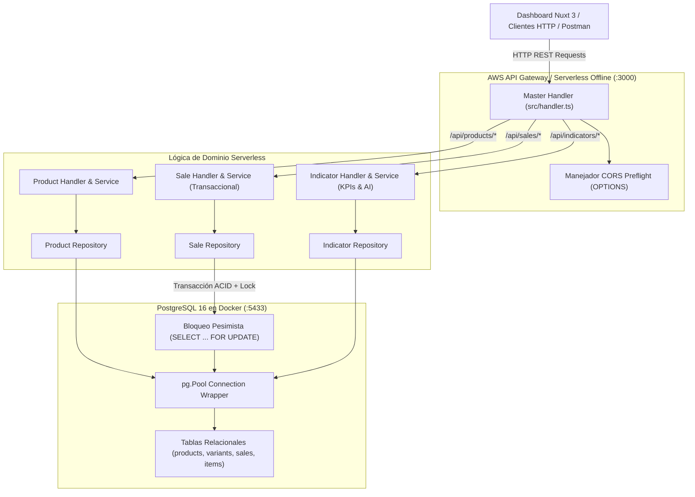

# B-Life Store - Serverless REST API & Business Dashboard

Solución Full-Stack de alto rendimiento para **B-Life Suplementos & Bienestar**, diseñada bajo arquitectura Serverless (AWS Lambda y API Gateway) con persistencia relacional en **PostgreSQL** y un panel de administración web moderno desarrollado en **Nuxt 3** y **Quasar Framework**.

---

## Índice

1. [Visión General](#visión-general)
2. [Stack Tecnológico](#stack-tecnológico)
3. [Arquitectura del Sistema](#arquitectura-del-sistema)
4. [Modelo de Datos y Diagrama ERD](#modelo-de-datos-y-diagrama-erd)
5. [Lógica de Negocio y Fórmulas Matemáticas](#lógica-de-negocio-y-fórmulas-matemáticas)
6. [Estrategias de Concurrencia y Rendimiento](#estrategias-de-concurrencia-y-rendimiento)
7. [Requisitos Previos e Instalación Local](#requisitos-previos-e-instalación-local)
8. [Catálogo de Endpoints y Ejemplos cURL](#catálogo-de-endpoints-y-ejemplos-curl)
9. [Colección de Postman](#colección-de-postman)
10. [Pruebas Automatizadas](#pruebas-automatizadas)
11. [Estrategia de Ramas y Git Flow](#estrategia-de-ramas-y-git-flow)

---

## Visión General

El proyecto resuelve de forma integral las necesidades comerciales y analíticas de **B-Life**:
* **Gestión de Catálogo Multivariante:** Soporte para productos con $N$ variantes (presentaciones, tamaños, dosis), cada una identificada por un código **SKU único e irrepetible**, precio de venta, costo de adquisición e inventario independiente.
* **Procesamiento Transaccional de Ventas Multicanal:** Registro de órdenes provenientes de múltiples canales de distribución (`AMAZON_MX`, `MERCADOLIBRE`, `BLIFE_SHOPIFY`, `TIENDA_FISICA`, `LIVERPOOL`, `WHATSAPP`) con deducción atómica de stock en tiempo real y asignación de folios consecutivos (`VTA-YYYY-XXXX`).
* **Inteligencia de Negocio y KPIs:** Endpoints dedicados para el cálculo de productos estrella (Top Ventas), utilidad neta y margen porcentual (*¿Cuánto gana vs. cuánto gasta la empresa?*), desglose de cuota de mercado por canal y motor de recomendaciones cruzadas (*Cross-Selling*) basado en afinidad de canasta.
* **Dashboard Web Desacoplado:** Interfaz gráfica desarrollada con Nuxt 3 y Quasar Framework alojada en su propio repositorio independiente (`blife-frontend`).

> [!NOTE]
> **Repositorio Frontend:** El panel de administración web ha sido desacoplado a su propio repositorio independiente: [`blife-frontend`](../blife-frontend). Consulte su respectivo `README.md` para su instalación y ejecución.

---

## Stack Tecnológico

| Capa | Tecnología | Versión | Propósito |
| :--- | :--- | :--- | :--- |
| **Backend Runtime** | Node.js (LTS) | `v20.18.2` | Entorno compatible con el runtime `nodejs20.x` de AWS Lambda. |
| **Lenguaje** | TypeScript | `^5.4.5` | Tipado estricto en entidades, DTOs y lógica de negocio. |
| **Arquitectura CPU** | ARM64 (AWS Graviton) | Modern | Mayor rendimiento y ~20% menor costo de ejecución en Lambda. |
| **Framework Serverless** | Serverless Framework | `v3.38.0` | Orquestación de infraestructura como código y emulación offline local. |
| **Emulador Local** | serverless-offline | `v13.3.3` | Simulación local de API Gateway y AWS Lambda en el puerto `3000`. |
| **Base de Datos** | PostgreSQL (Alpine) | `16` | Motor relacional robusto con transacciones ACID, secuencias y bloqueos pesimistas. |
| **Contenerización** | Docker & Compose | Modern | Aislamiento del servicio de PostgreSQL mapeado en puerto host `5433:5432`. |
| **Observabilidad** | Structured JSON Logger | Nativo | Logs estructurados con nivel, timestamp y `awsRequestId` para CloudWatch. |
| **Testing** | Jest & ts-jest | `v29.x` / `v30.x` | Suite completa con 41 pruebas unitarias aprobadas al 100%. |
| **CI / CD** | GitHub Actions | Modern | Flujo automatizado de validación, pruebas Jest y build de TypeScript en cada push/PR. |
| **Gestor de Paquetes** | pnpm | `v10.x` | Gestión determinista y veloz de dependencias. |

---

## Arquitectura del Sistema

La solución adopta una **Arquitectura en Capas (Layered / Clean Architecture)** dentro de una función AWS Lambda única que actúa como despachador de solicitudes (*Single Lambda Dispatcher*), enrutando eventos HTTP hacia controladores de dominio especializados:



### Organización del Código Fuente

```text
/var/www/html/blife/
├── .github/
│   └── workflows/ci.yml    # Pipeline CI GitHub Actions (Lint, Jest, TypeScript Build)
├── src/
│   ├── common/             # Errores (AppError), respuestas CORS, validaciones UUID, parser JSON y Logger
│   ├── config/             # Configuración del pool de PostgreSQL (max 2) y transacciones ACID
│   ├── db/                 # DDL relacional (init.sql con secuencias), migrador y seeder de catálogo B-Life
│   ├── modules/
│   │   ├── products/       # Tipos, Repositorio, Servicio y Handler de Productos con Variantes SKU
│   │   ├── sales/          # Tipos, Repositorio, Servicio y Handler de Ventas Transaccionales e Idempotencia
│   │   └── indicators/     # Tipos, Repositorio, Servicio y Handler de KPIs y Analítica de Negocio
│   └── handler.ts          # AWS Lambda Master Router con despacho exacto y event-loop optimizado
├── tests/                  # 41 pruebas unitarias (servicios, controladores, idempotencia y reglas de negocio)
├── docs/                   # Colección exportada de Postman (postman_collection.json)
├── docker-compose.yml      # Definición del contenedor PostgreSQL 16
└── serverless.yml          # Declaración de infraestructura serverless (Node.js 20.x, ARM64 Graviton)
```

> [!TIP]
> **Repositorio Frontend:** El panel web interactivo de administración se encuentra en su propio repositorio: [`blife-frontend`](../blife-frontend). Consulte su `README.md` para ejecutar la aplicación en el puerto `3001`.

---

## Modelo de Datos y Diagrama ERD

El diseño de la base de datos garantiza la **Tercera Forma Normal (3NF)**, integridad referencial mediante claves foráneas con borrado en cascada y restricciones de unicidad sobre los códigos de identificación SKU:

```mermaid
erDiagram
    PRODUCTS ||--o{ PRODUCT_VARIANTS : "tiene N variantes"
    SALES ||--o{ SALE_ITEMS : "contiene partidas"
    PRODUCT_VARIANTS ||--o{ SALE_ITEMS : "es vendido en"

    PRODUCTS {
        uuid id PK "Identificador único"
        varchar name "Nombre comercial del producto"
        text description "Descripción de fórmula y beneficios"
        varchar category "Categoría (Minerales, Proteínas, etc.)"
        varchar brand "Marca (B-Life)"
        varchar status "Estado (ACTIVE / INACTIVE)"
        timestamp created_at "Fecha de registro"
        timestamp updated_at "Fecha de actualización"
    }

    PRODUCT_VARIANTS {
        uuid id PK "Identificador único de variante"
        uuid product_id FK "Producto padre"
        varchar sku UK "Código SKU único e irrepetible"
        varchar presentation "Presentación (180 cápsulas, 500g, etc.)"
        numeric price "Precio de venta al público"
        numeric cost "Costo unitario de mercancía"
        integer stock "Inventario disponible"
        timestamp created_at "Fecha de creación"
        timestamp updated_at "Fecha de actualización"
    }

    SALES {
        uuid id PK "Identificador de la orden"
        varchar folio UK "Folio correlativo (VTA-YYYY-XXXX)"
        varchar channel "Canal de venta (AMAZON_MX, SHOPIFY, etc.)"
        varchar customer_name "Nombre del cliente"
        varchar customer_email "Correo del cliente"
        numeric total_amount "Monto total cobrado"
        numeric total_cost "Costo total de las mercancías vendidas"
        varchar status "Estado (COMPLETED / CANCELLED)"
        text notes "Observaciones de la orden"
        timestamp created_at "Fecha de la transacción"
    }

    SALE_ITEMS {
        uuid id PK "Identificador de partida"
        uuid sale_id FK "Venta asociada"
        uuid variant_id FK "Variante vendida"
        varchar sku "Snapshot del SKU al momento de venta"
        integer quantity "Unidades vendidas"
        numeric unit_price "Precio unitario cobrado"
        numeric unit_cost "Costo unitario al momento de venta"
        numeric subtotal "Importe total (quantity * unit_price)"
        numeric subtotal_cost "Costo total (quantity * unit_cost)"
        timestamp created_at "Fecha de registro"
    }
```



### Índices de Alto Rendimiento Implementados

Para garantizar tiempos de respuesta en milisegundos incluso con millones de registros, se implementaron índices B-Tree específicos:
* `idx_product_variants_sku`: Búsquedas ultrarrápidas $O(\log n)$ por código SKU.
* `idx_product_variants_product_id`: Uniones inmediatas entre productos y variantes.
* `idx_sales_channel`: Agrupación acelerada para reportes de participación de canal.
* `idx_sales_created_at`: Filtros cronológicos para cálculo de utilidades por período.
* `idx_sale_items_sale_id` y `idx_sale_items_variant_id`: Agregaciones de volumen de ventas y algoritmos de afinidad de canasta.

---

## Lógica de Negocio y Fórmulas Matemáticas

### 1. Cuál es mi Utilidad (Profitability Analysis)

Permite a la dirección de **B-Life** conocer con exactitud matemática cuánto dinero ingresa a la empresa frente a cuánto se gasta en el costo de los productos vendidos:

$$\text{Ingresos Totales (Venta)} = \sum (\text{item.quantity} \times \text{item.unit\_price})$$

$$\text{Costos Totales (Gastos)} = \sum (\text{item.quantity} \times \text{item.unit\_cost})$$

$$\text{Utilidad Bruta} = \text{Ingresos Totales} - \text{Costos Totales}$$

$$\text{Margen Bruto Porcentual (\%)} = \left(\frac{\text{Utilidad Bruta}}{\text{Ingresos Totales}}\right) \times 100$$

*Ejemplo práctico del seed:* Con \$4,710.00 MXN en ventas y \$1,585.00 MXN en costos de mercancía, la empresa genera **\$3,125.00 MXN de utilidad neta** con un margen de ganancia del **66.35%**.

### 2. Top Canales de Venta (% de Participación)

Evalúa la penetración de cada canal comercial sobre la facturación global de la compañía:

$$\% \text{ Participación del Canal } i = \left(\frac{\text{Ingresos Generados en Canal } i}{\sum \text{Ingresos de Todos los Canales}}\right) \times 100$$

Canales soportados: `AMAZON_MX`, `MERCADOLIBRE`, `BLIFE_SHOPIFY`, `TIENDA_FISICA`, `LIVERPOOL`, `WHATSAPP`.

### 3. Motor de Recomendaciones Cruzadas (Market Basket Co-Occurrence)

Para sugerir productos complementarios (*Cross-Selling*), el sistema analiza las órdenes históricas:
1. Identifica qué otros productos fueron adquiridos en las mismas ventas que el producto consultado ($A$).
2. Cuenta la frecuencia de co-ocurrencia:
   $$\text{Frecuencia}(A \cap B) = \text{Count}(\text{Ventas con } A \text{ y } B)$$
3. Ordena las coincidencias de mayor a menor frecuencia.
4. **Mecanismo de Respaldo (Fallback Inteligente):** Si el producto es nuevo o no posee suficientes ventas compartidas, el algoritmo recomienda automáticamente productos populares de la **misma categoría**, o en su defecto, los suplementos más vendidos del catálogo general.

---

## Estrategias de Concurrencia y Rendimiento

En escenarios de alto tráfico (como promociones Hot Sale o Prime Day), múltiples clientes pueden intentar comprar el mismo SKU simultáneamente. Para garantizar consistencia absoluta y resiliencia en la nube:

1. **Bloqueo Pesimista de Filas (`SELECT ... FOR UPDATE`):**
   Al procesar `POST /api/sales`, el servicio abre una transacción de PostgreSQL y bloquea exclusivamente las filas de las variantes solicitadas. Cualquier otra transacción concurrente que intente acceder al mismo SKU esperará hasta que la transacción actual confirme (`COMMIT`) o descarte (`ROLLBACK`).
2. **Prevención Matemática de Deadlocks (Orden Determinista):**
   Para evitar interbloqueos (*deadlocks*) cuando dos órdenes simultáneas compran los mismos productos en orden inverso, el sistema **ordena alfabéticamente los items por SKU** antes de adquirir los locks `FOR UPDATE`.
3. **Validación Atómica de Inventario:**
   Si $\text{stock\_disponible} < \text{cantidad\_solicitada}$, la transacción realiza un `ROLLBACK` inmediato y retorna un código HTTP `400 Bad Request` indicando el SKU exacto con existencias insuficientes.
4. **Secuencia Atómica de Folios (`sale_number_seq`):**
   Los folios se generan directamente con la secuencia atómica de PostgreSQL `nextval('sale_number_seq')`, eliminando al 100% las condiciones de carrera de folios duplicados (`VTA-YYYY-XXXX`).
5. **Idempotencia de Órdenes (`Idempotency-Key`):**
   Soporte para cabecera `Idempotency-Key` en `POST /api/sales`. Si la red del cliente falla y reintenta la misma orden, la API devuelve la venta ya creada sin duplicar cargos ni descontar inventario dos veces.
6. **Integridad Referencial y Manejo de Conflictos (409):**
   La base de datos restringe la eliminación de productos que ya cuenten con historial en `sale_items`. La API captura esto como una regla de negocio y responde con un código `409 Conflict` amigable, invitando a archivar o desactivar el producto.
7. **Ajuste del Pool para Arquitecturas Serverless:**
   Para prevenir la saturación de conexiones en PostgreSQL ante ráfagas concurrentes de Lambdas, el pool se autolimita a `max: 2` conexiones por contenedor y se desactiva la espera del bucle de eventos (`context.callbackWaitsForEmptyEventLoop = false`).
8. **Arquitectura ARM64 (AWS Graviton):**
   Configurado en `serverless.yml` para ofrecer hasta 20% mejor rendimiento y menor latencia en *cold starts*.

---

## Requisitos Previos e Instalación Local

### Requisitos del Sistema
* **Node.js:** Versión 20.x LTS (`.nvmrc` incluido: `20.18.2`).
* **pnpm:** Versión 9 o 10 (`npm install -g pnpm`).
* **Docker & Docker Compose:** Activo en la máquina host.

### Paso 1: Configurar la versión de Node.js
```bash
cd /var/www/html/blife
nvm use
```

### Paso 2: Instalar Dependencias
```bash
pnpm install
```

### Paso 3: Configurar Variables de Entorno
El archivo `.env` ya viene preconfigurado con el puerto host `5433` para evitar conflictos con instancias locales de PostgreSQL que ocupen el puerto 5432:
```ini
NODE_ENV=dev
PORT=3000
DB_HOST=localhost
DB_PORT=5433
DB_USER=blife_admin
DB_PASSWORD=blife_secret_password
DB_NAME=blife_store_db
```

### Paso 4: Levantar PostgreSQL en Docker
```bash
docker compose up -d
```
*El contenedor monta automáticamente el script de inicialización DDL relacional.*

### Paso 5: Ejecutar Migraciones y Poblado de Datos (Seed)
Ejecuta el script que inserta productos reales de B-Life (Citrato de Magnesio, Colágeno Hidrolizado, Omega 3, Multivitamínico, Vitamina D3) con variantes y órdenes multicanal:
```bash
pnpm seed
```

### Paso 6: Iniciar la API Serverless (Puerto 3000)
```bash
pnpm dev
```
La API estará disponible en `http://localhost:3000/api`.

### Paso 7: Iniciar el Dashboard Frontend (Puerto 3001)
El frontend se ejecuta desde su propio repositorio independiente:
```bash
cd /var/www/html/blife-frontend
pnpm install
pnpm dev
```
Abre tu navegador en: **`http://localhost:3001`**

---

## Catálogo de Endpoints y Ejemplos cURL

### 0. Health Check
```bash
curl -X GET http://localhost:3000/api/health
```

---

### 1. Productos y Variantes (CRUD)

#### Listar Productos (Paginado con Filtros)
```bash
curl -X GET "http://localhost:3000/api/products?page=1&limit=10&search=Magnesio&category=Minerales"
```

#### Obtener Producto por ID
```bash
curl -X GET http://localhost:3000/api/products/11111111-1111-1111-1111-111111111111
```

#### Buscar Variante por Código SKU Único
```bash
curl -X GET http://localhost:3000/api/products/sku/BL-MAG-CIT-180
```

#### Crear Producto con Múltiples Variantes
```bash
curl -X POST http://localhost:3000/api/products \
  -H "Content-Type: application/json" \
  -d '{
    "name": "Ashwagandha KSM-66 & Rhodiola",
    "description": "Suplemento adaptógeno para control del estrés y vitalidad",
    "category": "Adaptógenos",
    "brand": "B-Life",
    "variants": [
      {
        "sku": "BL-ASH-90CAP",
        "presentation": "Frasco con 90 cápsulas",
        "price": 399.00,
        "cost": 145.00,
        "stock": 80
      },
      {
        "sku": "BL-ASH-180CAP",
        "presentation": "Frasco con 180 cápsulas",
        "price": 699.00,
        "cost": 260.00,
        "stock": 50
      }
    ]
  }'
```

#### Actualizar Producto y Variantes
```bash
curl -X PUT http://localhost:3000/api/products/11111111-1111-1111-1111-111111111111 \
  -H "Content-Type: application/json" \
  -d '{
    "name": "Citrato de Magnesio Puro 500mg (Fórmula Optimizada)",
    "description": "Mineral biodisponible para relajación muscular",
    "category": "Minerales",
    "brand": "B-Life",
    "variants": [
      {
        "sku": "BL-MAG-CIT-180",
        "presentation": "Frasco con 180 cápsulas",
        "price": 369.00,
        "cost": 120.00,
        "stock": 115
      }
    ]
  }'
```

#### Eliminar Producto
```bash
curl -X DELETE http://localhost:3000/api/products/11111111-1111-1111-1111-111111111111
```

---

### 2. Ventas Multicanal (Transaccional)

#### Listar Ventas Registradas
```bash
curl -X GET "http://localhost:3000/api/sales?page=1&limit=10&channel=AMAZON_MX"
```

#### Obtener Detalle de Venta por ID
```bash
curl -X GET http://localhost:3000/api/sales/a1111111-aaaa-1111-aaaa-111111111111
```

#### Registrar Venta Multicanal (Transaccional con Bloqueo de Stock)
```bash
curl -X POST http://localhost:3000/api/sales \
  -H "Content-Type: application/json" \
  -d '{
    "channel": "BLIFE_SHOPIFY",
    "customerName": "Mariana López Sánchez",
    "customerEmail": "mariana.lopez@example.com",
    "items": [
      {
        "sku": "BL-MAG-CIT-180",
        "quantity": 2
      },
      {
        "sku": "BL-COL-HYD-500",
        "quantity": 1
      }
    ],
    "notes": "Compra directa en tienda online con envío express"
  }'
```

---

### 3. Indicadores de Negocio y KPIs

#### KPI: Top Productos Más Vendidos
```bash
curl -X GET "http://localhost:3000/api/indicators/top-products?limit=5"
```

#### KPI: Cuál es mi Utilidad (Ingresos, Costos y Margen %)
```bash
curl -X GET http://localhost:3000/api/indicators/profitability
```

#### KPI: Top Canales de Venta (% Participación)
```bash
curl -X GET http://localhost:3000/api/indicators/top-channels
```

#### KPI: Productos Recomendados (Cross-Selling)
```bash
curl -X GET "http://localhost:3000/api/indicators/recommendations?productId=11111111-1111-1111-1111-111111111111&limit=4"
```

---

## Colección de Postman

El archivo de la colección completa se encuentra en:
```text
docs/postman_collection.json
```

### Pasos para Importar en Postman:
1. Abre **Postman**.
2. Haz clic en el botón superior **Import**.
3. Selecciona o arrastra el archivo `docs/postman_collection.json`.
4. La colección cuenta con la variable de entorno `baseUrl` preconfigurada en `http://localhost:3000/api`.

---

## Pruebas Automatizadas

La suite de pruebas unitarias y de integración cubre todas las validaciones de negocio, unicidad de SKU, restricciones de stock y cálculos financieros:

```bash
pnpm test
```

### Resultados de la Suite de Pruebas:
```text
PASS tests/handlers.test.ts
  AWS Lambda Handlers Unit Tests
    Main handler (src/handler.ts)
      ✓ debe responder 200 en peticiones preflight OPTIONS
      ✓ debe responder 200 en el health check (/api/health)
      ✓ debe responder 404 para rutas no reconocidas
      ✓ no debe permitir falsos positivos de prefijos como /api/productsfoo
      ✓ debe despachar correctamente a /api/products/{id} con UUID válido
      ✓ debe despachar correctamente a /api/sales/{id} con UUID válido
    indicatorsHandler (src/modules/indicators/indicator.handler.ts)
      ✓ debe rechazar métodos distintos a GET con código 405
      ✓ debe retornar 404 si la sub-ruta de indicador no existe
      ✓ debe retornar 404 en subrutas anidadas no reconocidas como /api/indicators/x/top-products
      ✓ debe responder 200 y datos al consultar /top-products
      ✓ debe responder 200 y datos al consultar /profitability
      ✓ debe responder 200 y datos al consultar /top-channels
      ✓ debe responder 200 y datos al consultar /recommendations
    productsHandler (src/modules/products/product.handler.ts)
      ✓ debe responder 400 si se envía un ID que no es un UUID válido
      ✓ debe responder 400 si el cuerpo en POST está vacío
      ✓ debe responder 400 si el JSON en POST está malformado
      ✓ debe crear un producto con código 201 en POST válido
      ✓ debe consultar producto por SKU en /api/products/sku/{sku}
    salesHandler (src/modules/sales/sale.handler.ts)
      ✓ debe responder 400 si se envía un ID de venta que no es un UUID válido
      ✓ debe responder 400 si el JSON en POST está malformado
      ✓ debe registrar venta con código 201 en POST válido

PASS tests/sales.test.ts
  SaleService Unit Tests
    createSale
      ✓ debe rechazar una venta sin canal especificado
      ✓ debe rechazar una venta sin nombre de cliente
      ✓ debe rechazar una venta sin partidas o items
      ✓ debe rechazar items con cantidades negativas o cero
      ✓ debe registrar una venta exitosa calculando totales correctamente
    getSaleById
      ✓ debe arrojar NotFoundError si la venta no existe

PASS tests/products.test.ts
  ProductService Unit Tests
    createProduct
      ✓ debe rechazar un producto sin nombre
      ✓ debe rechazar un producto sin variantes
      ✓ debe rechazar variantes con SKUs duplicados en la misma petición
      ✓ debe rechazar variantes con precio o costo negativo
      ✓ debe rechazar variantes con SKU que ya existe en la base de datos
      ✓ debe crear un producto exitosamente cuando todas las variantes tienen SKU válido y único
    getProductBySku
      ✓ debe retornar la variante y su producto padre cuando el SKU existe
      ✓ debe arrojar NotFoundError cuando el SKU no existe
    deleteProduct
      ✓ debe rechazar la eliminación con ConflictError si el producto tiene ventas asociadas
      ✓ debe eliminar exitosamente el producto si no tiene ventas asociadas

PASS tests/indicators.test.ts
  IndicatorService Unit Tests
    getTopProducts
      ✓ debe retornar los productos más vendidos ordenados por unidades e ingresos
    getProfitability (Cuál es mi utilidad)
      ✓ debe calcular correctamente los ingresos, gastos, utilidad bruta y margen porcentual
    getTopChannels
      ✓ debe retornar el ranking de canales de venta con su porcentaje de participación
    getRecommendations
      ✓ debe retornar productos comprados frecuentemente juntos cuando hay historial cruzado

Test Suites: 4 passed, 4 total
Tests:       41 passed, 41 total
Snapshots:   0 total
Time:        ~1.3s
```

---

## Integración Continua (CI / CD Pipeline)

El proyecto cuenta con un flujo automatizado de integración continua mediante **GitHub Actions** (`.github/workflows/ci.yml`):
* Se dispara en cada `push` o `pull_request` a las ramas `main` y `dev`.
* Configura Node.js `20.x` y `pnpm`.
* Ejecuta la suite de pruebas automatizadas (`pnpm test`).
* Valida la compilación limpia del código en TypeScript (`pnpm build`).

---

## Estrategia de Ramas y Git Flow

El repositorio sigue una convención estricta de ramas y mensajes semánticos (*Conventional Commits*):

* `dev`: Rama activa de desarrollo y nuevas funcionalidades.
* `qa`: Rama de estabilización, pruebas integradas y validación previa a despliegue.
* `main`: Rama de producción estable.

### Formato de Commits Empleado:
```text
<tipo>(<alcance>): <descripción concisa en minúsculas>
```
* `feat`: Nuevas características (productos, ventas, kpis, frontend).
* `fix`: Correcciones de errores o ajustes de concurrencia.
* `docs`: Documentación técnica, diagramas y colecciones Postman.
* `test`: Suites de pruebas unitarias y de integración.
* `chore`: Configuración de dependencias, entornos y Docker.

